# ClickGuard

Detecting articles with clickbait headlines.

- [1. Installation manual](#1-installation-manual)
- [2. User manual](#2-user-manual)
  - [2.1. Overview](#21-overview)
  - [2.2. Post-click detection](#22-post-click-detection)
  - [2.3. Pre-click detection](#23-pre-click-detection)

## 1. Installation manual

To start using our app, one should follow the steps below.

- Download the folder containing extension files. If it was downloaded as a zip, unpack it.
- Open a browser, click on the extensions icon  and go to *manage extensions* page.
- Turn on developer mode using a switch in the upper right corner.

  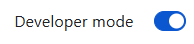

- Click *load unpacked* button in the top left corner. In the popup select previously downloaded folder with the extension files.
- A new tile presenting the extension should appear.

  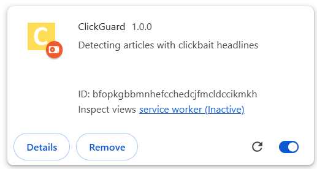

- In order to use all functionalities, pin the extension to the bar by clicking pin icon.

  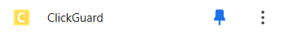

## 2. User manual

### 2.1. Overview

Extension has two main modes: post-click detection, for running detection after entering an article page, and pre-click detection, for detecting clickbaits beforehand. Main UI element is a popup, where you can trigger actions manually or set them to trigger automatically.

#### 2.1.1. Popup

In order to start using the extension, click on the yellow extension icon.

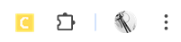

After that, popup will appear. In the popup user can do several things.

- Access options page by clicking on the gear icon.
- Perform manual check by clicking yellow *Check* button.
- View predictions results.

The default popup design can be seen in Figure 2.1. Figure 2.2 shows the prediction output, which consists of clickbait probability, explanation and optionally spoiler.

<table>
  <tr>
    <td align="center">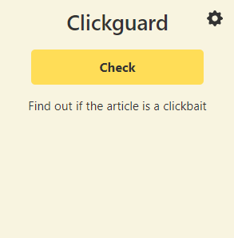</td>
    <td align="center">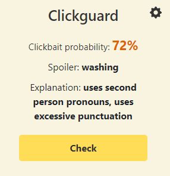</td>
  </tr>
  <tr>
    <td align="center"><em>Figure 2.1: Before detection</em></td>
    <td align="center"><em>Figure 2.2: After detection</em></td>
  </tr>
</table>

#### 2.1.2. Options page

In the options page, user can configure the behaviour of the app. Settings are saved in the browser sync storage. More detailed decription of available options is presented in next sections.

#### 2.1.3. Badges and Icons

The extension icon is used not only to trigger the popup, but also to display badges. Badges are shown in the extension bar on processed article pages in post-click detection. If the probability of title being a clickbait is below 0.4, the green icon is shown. If the probability is between 0.4 and 0.6, a yellow warning sign is displayed. For titles with a clickbait probability exceeding 0.6, a red exclamation mark badge is shown to alert a user.

<table>
  <tr>
    <td align="center"></td>
    <td align="center"></td>
    <td align="center"></td>
    <td align="center">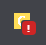</td>
  </tr>
  <tr>
    <td align="center"><em>(a) Default extension icon</em></td>
    <td align="center"><em>(b) Icon with badge for non-clickbait</em></td>
    <td align="center"><em>(c) Icon with badge for potential clickbait</em></td>
    <td align="center"><em>(d) Icon with badge for clickbaits</em></td>
  </tr>
</table>

<em>Figure 2.3: Badges</em>

In the pre-click detection, icons are placed to the right of the link titles. As previously, the red one is used for clickbait titles, yellow for potential clickbait, and green for titles with low probability of being clickbait. Examples are shown in Figure 2.4 and in Figure 2.5.

  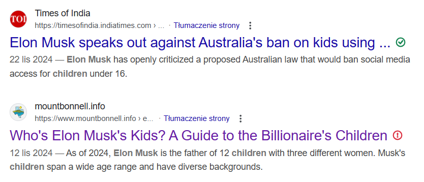 
  <em>Figure 2.4: Pre-click warning design</em>

  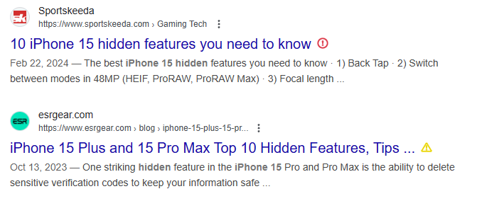 
  <em>Figure 2.5: Pre-click warning design</em>

### 2.2. Post-click detection

The first mode is post-click detection. It scans the content and runs detection after the user enters a desired article page.

#### 2.2.1. Configuration

There are 4 different configurations for this mode.

- **Manual-only**, where the user manually triggers detection by clicking the "check" button in the popup.
- **Monitored Detection**, where the extension automatically checks for clickbaits on sites specified by the user.
- **Semi-automatic**, where the extension automatically checks for clickbaits on sites specified by the user and on pages containing relevant meta tag (`<meta property="og:type" content="article" />`).
- **Automatic**, where the extension checks for clickbaits on every page.

Preferred detection option can be chosen in the options page. To save the choice, click on the 'save' button.

  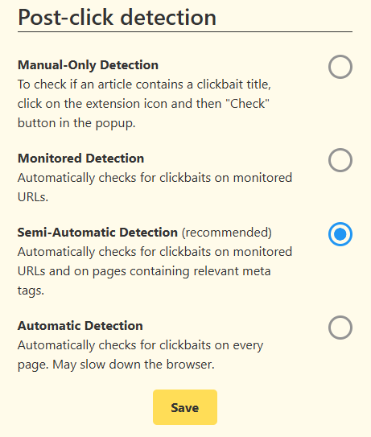 
  <em>Figure 2.6: Post-click settings panel</em>

#### 2.2.2. Adding sites to the monitored sites list

Sites can be added to the list (as well as deleted) in the options page. Use asterix to match any characters. Asterix is added at the beginning, if the provided pattern does not start with *http*.

**HINT:**
When adding a url, try to represent the article url patterns. For example, `*thesun.co.uk/*` is too loose and will match also home pages. Pattern `*thesun.co.uk/*/*/*/` properly matches url schema `https://www.thesun.co.uk/<section>/<id>/<title>/`.

  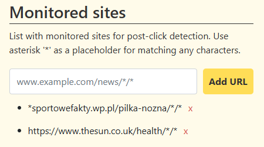 
  <em>Figure 2.7: Monitored sites panel</em>

#### 2.2.3. Detection pipeline

After detection is made:

- A badge is displayed on the extension icon.
- Prediction results are displayed in the popup.
- Popup pops up automatically, if the prediction is a clickbait.

Spoilers are generated only for articles with titles classified as clickbaits. However, user can use the toggle switch to turn on and off spoiler generation.

  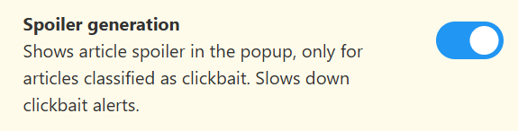 
  <em>Figure 2.8: Spoiler generation toggle</em>

### 2.3. Pre-click detection

In the pre-click mode, detection is run before a user accesses an article.

#### 2.3.1. Configurations

There are two configurations available. One for Google Search, and one for The Sun news portal. It can be turned on using toggle switches in the options panel.

  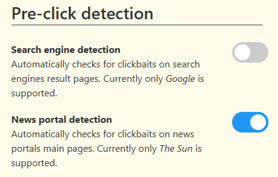 
  <em>Figure 2.9: Pre-click settings panel</em>

